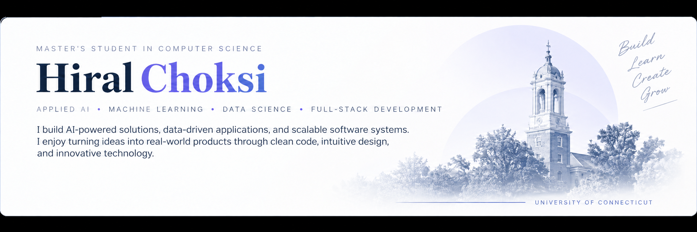

Master’s student in Computer Science at the University of Connecticut  
**Graduating December 2026 · Available for full-time roles starting January 2027**

My projects explore how machine learning, language models, computer vision, and interactive analytics can help interpret data and build useful applications.

I’m seeking opportunities in **Data Science, Applied AI, and Machine Learning**.

## Selected Projects

### [LLM-Powered README Generator](https://github.com/HIRAL13CHOKSI/-readme-gen-ai)
**Python · LLM APIs · AST Analysis**

Generates documentation from Python scripts using AST-based code analysis and large language models. Includes evaluation workflows for AST-grounded generation and an LLM-only baseline.

### [Tobacco Tax & Consumption Analysis](https://github.com/HIRAL13CHOKSI/tobacco-tax-consumption-analysis)
**pandas · Plotly Dash · scikit-learn · Statistical Visualization**

Exploratory analysis of U.S. state-level cigarette taxation and consumption patterns from 1990–2019. Includes interactive visualizations of temporal trends, geographic differences, and state clusters.

### [Automated Image Description](https://github.com/HIRAL13CHOKSI/AUTOMATED-IMAGE-DESCRYPTION)
**TensorFlow Lite · Computer Vision · Flask**

A collaborative image-captioning application with a web interface and model inference components. The repository includes architecture documentation and example outputs.

### [Music Recommendation Prototype](https://github.com/HIRAL13CHOKSI/MICROSOFT-HACKATHON-)
**FriendliAI · FastAPI · Streamlit · Spotify · Opik**

A collaborative hackathon prototype exploring conversational music recommendations through LLM inference, Spotify lookup, and model-interaction tracing.

### [Geofencing AI](https://github.com/HIRAL13CHOKSI/Geofencing-AI)
**YOLOv8 · OpenCV · Python**

A computer-vision prototype exploring object detection and monitoring of predefined safe-area boundaries in video.

## Technologies Across My Projects

| Area | Technologies |
|---|---|
| Data Analysis | Python, pandas, NumPy |
| Machine Learning | scikit-learn, clustering |
| Applied AI | OpenAI and Gemini APIs, FriendliAI, Python AST analysis |
| Computer Vision | TensorFlow Lite, YOLOv8, OpenCV |
| Visualization & Applications | Plotly, Dash, Streamlit, Flask, FastAPI |

## Areas of Interest

- Exploratory data analysis and statistical modeling
- Machine learning evaluation and practical applications
- Generative AI and AI-assisted developer tools
- Computer vision and interactive analytical applications

## Opportunities

Seeking **full-time Data Science, Applied AI, and Machine Learning opportunities starting January 2027**.
