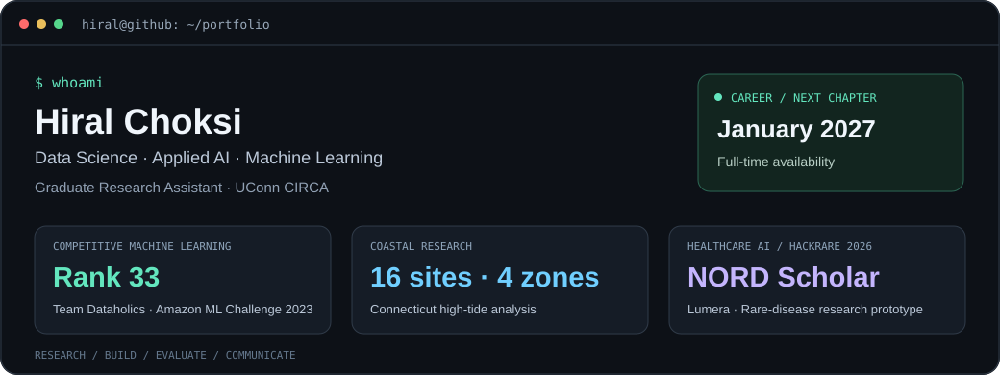

# Hi, I'm Hiral Choksi

**Graduate Research Assistant at UConn CIRCA | Data Science · Applied AI · Machine Learning**

I build data-driven workflows and interactive applications across coastal resilience, healthcare and public policy. My work spans data preparation, machine learning, computer vision, geospatial analysis and communicating results through visualizations.

🎓 Master's student at the University of Connecticut · Graduating December 2026  
💼 Seeking full-time Data Science, Applied AI and Machine Learning roles starting January 2027

## 🌱 Currently

- Developing coastal flood analysis and high-tide validation workflows through my graduate research assistantship at CIRCA.
- Exploring machine learning, computer vision and interactive analytics through research and applied projects.
- Preparing for full-time opportunities in data science, applied AI and machine learning.

## Featured projects

### [MyCoast: Photo-Based Coastal Flood Analysis](https://github.com/HIRAL13CHOKSI/mycoast-flood-photo-analysis)
**Python · Computer Vision · Geospatial Analysis · Gradio**

Independently developed a research workflow and interactive prototype combining flood-photo analysis, reference-object detection and environmental context to explore flood-depth screening. The repository includes the workflow and demonstration.

### [Coastal High-Tide Detection & Validation](https://github.com/HIRAL13CHOKSI/connecticut-high-tide-detection)
**Python · Time-Series Analysis · Geospatial Mapping**

Built a zone-aware workflow connecting **16 Connecticut monitoring sites across four tidal zones**. The project report gives mean absolute timing differences of **3.75 minutes in Zone 3** and **7.00 minutes in Zone 2** compared with NOAA-predicted tides. The validation period and sample size need confirmation; see the repository for context.

### [Adaptive Healthcare Chatbot](https://github.com/HIRAL13CHOKSI/adaptive-healthcare-chatbot)
**Master's Capstone · Accessible AI · RAG · FHIR**

Designed an accessibility-focused patient-portal chatbot and proposed a modular architecture for retrieval and healthcare interoperability. The capstone documents user research and a limited-scope MVP using simulated or sandbox environments.

### [Lumera AI: Rare Disease Research](https://github.com/HIRAL13CHOKSI/lumera-rare-disease-ai)
**HackRare 2026 · Applied AI · Bioinformatics · Next.js · Node.js**

Collaborated on a hackathon prototype exploring clinical trials, drug repurposing and rare-disease research. Its research interface illustrates a proposed single-cell RNA-seq augmentation and target-discovery workflow. Selected as a **NORD Scholarship recipient** for HackRare 2026. [Watch the team demo](https://shorturl.at/MJb8I).

### [Tobacco Tax & Consumption Analysis](https://github.com/HIRAL13CHOKSI/tobacco-tax-consumption-analysis)
**Python · pandas · Plotly Dash · scikit-learn**

Explored cigarette tax and consumption patterns across **51 U.S. jurisdictions from 1990–2019**, with clustering, geographic visualizations and an interactive dashboard. [Watch my project explanation](https://drive.google.com/file/d/1VQPzudktN7orBkBAI6gwrOCVk6wLSccK/view?usp=sharing).

### [NYC Airbnb Price Prediction](https://github.com/HIRAL13CHOKSI/nyc-airbnb-price-prediction)
**Python · pandas · scikit-learn · Regression**

Compared regression models on 2019 listing data. A tuned random forest achieved a **64.08 mean absolute error on the held-out test set** in the saved notebook output. The repository documents evaluation limitations and reproducibility status.

### [Amazon ML Challenge: Product Length Prediction](https://github.com/HIRAL13CHOKSI/Product-Length-AMAZON-CHALLENGE)
**Team Dataholics · Rank 33 · Python · Regression**

Our team placed **33rd** with a **49.46622 leaderboard score** in the Amazon ML Challenge 2023. The repository includes the leaderboard evidence, certificate and an exploratory notebook, with the public baseline distinguished from the final team solution.

## More projects

| Project | Focus |
|---|---|
| [Plant AI: Leaf Disease Detection](https://github.com/HIRAL13CHOKSI/plant-ai-disease-detection) | Collaborative MobileNet and TensorFlow project with a web interface and project poster |
| [Early Ocular Disease Detection](https://github.com/HIRAL13CHOKSI/ocular-disease-detection) | VGG-16 medical-image classification project; reported accuracy and evaluation limitations |
| [LLM-Powered README Generator](https://github.com/HIRAL13CHOKSI/-readme-gen-ai) | Python documentation generation with LLM APIs and AST analysis |
| [Geofencing AI](https://github.com/HIRAL13CHOKSI/Geofencing-AI) | YOLOv8 and OpenCV prototype for monitoring video boundaries |
| [Automated Image Description](https://github.com/HIRAL13CHOKSI/AUTOMATED-IMAGE-DESCRYPTION) | Collaborative image-captioning application using Flask and TensorFlow Lite |
| [Music Recommendation Prototype](https://github.com/HIRAL13CHOKSI/MICROSOFT-HACKATHON-) | Collaborative hackathon prototype using LLM inference, Spotify and Streamlit |

## Technologies

| Area | Tools and methods |
|---|---|
| Data analysis | Python, pandas, NumPy, statistical analysis |
| Machine learning | scikit-learn, regression, clustering, model evaluation |
| Applied AI | OpenAI and Gemini APIs, FriendliAI, Python AST analysis |
| Computer vision | TensorFlow/Keras, TensorFlow Lite, YOLOv8, OpenCV |
| Visualization and applications | Plotly, Dash, Gradio, Streamlit, Flask, FastAPI |

## 📬 Connect

[LinkedIn](https://www.linkedin.com/in/hiralchoksi) · [hiral.choksi.career@gmail.com](mailto:hiral.choksi.career@gmail.com)
